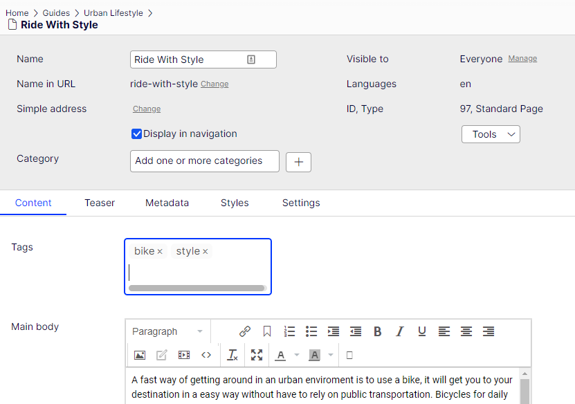
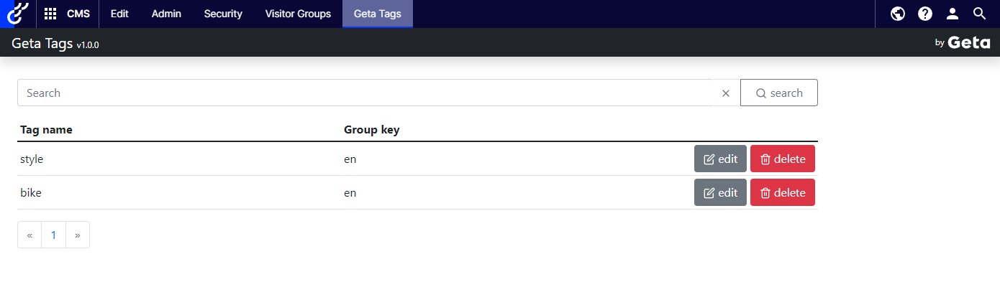
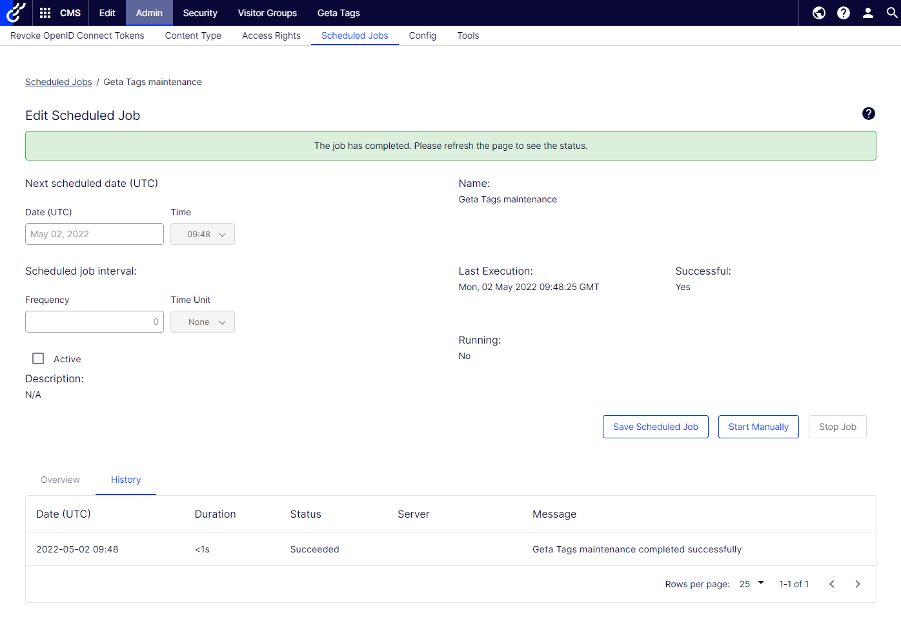

# Editor guide

## Tags property

Once the developer installed the package and defined a Tags property on a page or block the property will appear in the CMS.

In the text field, type a tag and press *Enter*. After pressing *Enter*, the tag is created. To remove the tag, click 'x' on the tag label.

## Geta Tags Management

In the Admin mode, Geta Tags management is available on the top menu. The management view provides ability to search, modify and delete a tag. The list keeps your current page and search when you edit, update or delete a tag.

Deleting a tag here does not remove it from content: content that still uses the tag adds it back when it is published. Renaming a tag likewise only renames the stored tag: content that still uses the old name adds the old tag back when it is published. To rename a tag in the content as well, tick *Check this box to edit existing tags in the content* when updating it.

## Geta Tags maintenance scheduled job

A scheduled job that synchronizes the tags with the content: it removes links to deleted content and to tags that the content no longer uses, and adds links that are missing. It never changes the content itself.

